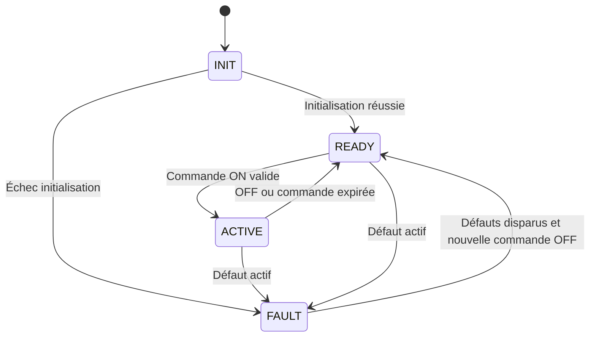

# Architecture et exigences

## Périmètre

Deux nœuds CAN et un PC. La version initiale commande seulement une LED : aucune régulation de moteur, aucun cloud, aucune IA. La priorité est une chaîne acquisition → communication → diagnostic → test réellement vérifiable.

## Nœud ECU

Modules prévus :

- `sensor` : lecture ADC et conversion de démonstration 0–100 °C simulés.
- `fault_manager` : défaut actif, historique en RAM et conditions de récupération.
- `output` : LED éteinte au démarrage, activable sous conditions.
- `can_transport` : réception, validation DLC/identifiant/version, émission périodique.
- `app` : machine à états et ordonnanceur coopératif.

Les interruptions CAN déposent les messages dans une file bornée ; les traitements applicatifs restent dans la boucle principale. Le comportement lors d'un débordement doit être mesuré et journalisé.

## Nœud diagnostic

Réception et décodage CAN, surveillance de fraîcheur ECU, conversion en lignes série et transmission des commandes PC. Il émet un heartbeat même sans PC ; seules les commandes de sortie explicites renouvellent l'autorisation de la LED.

## Interface PC

Connexion au port série choisi, affichage des valeurs et de leur ancienneté, bouton ON/OFF, bouton effacement historique, journaux CSV. Une valeur ancienne reste visible avec le statut PÉRIMÉ et ne doit jamais être présentée comme une mesure actuelle.

## Machine à états ECU

INIT, READY et FAULT imposent LED OFF. Une sortie de FAULT ne redémarre jamais la LED. L'initialisation CAN échouée reste en FAULT jusqu'à réinitialisation matérielle ; l'auto-récupération bus-off n'est pas incluse initialement.

## Exigences identifiées

| ID | Exigence | Vérification |
|---|---|---|
| R01 | Sortie OFF au démarrage | T01 |
| R02 | Acquisition toutes les 100 ms | T02 |
| R03 | Télémétrie toutes les 100 ms | T02 |
| R04 | LED ON seulement sans défaut et avec commandes fraîches | T03, T04 |
| R05 | Expiration ON après 1 000 ms sans commande valide | T05 |
| R06 | Défaut température à partir de 70,0 °C ; disparition sous 65,0 °C | T06 |
| R07 | Bouton de défaut simule mesure invalide et coupe la sortie | T07 |
| R08 | Diagnostic détecte télémétrie ECU absente depuis plus de 1 000 ms | T08 |
| R09 | ECU coupe la sortie sans heartbeat diagnostic depuis plus de 1 000 ms | T09 |
| R10 | Effacement historique ne masque pas un défaut actif | T10 |
| R11 | Trame mal formée ignorée, sans renouveler une commande | T11 |
| R12 | Événements exportables en CSV | T12 |

Les durées sont des objectifs de conception, pas des performances mesurées. Cible : boucle principale < 10 ms hors traitement périphérique ; mesurer la latence réelle avant de promettre une borne.

## Défaillances et récupération

- Défaut capteur : bit actif tant que bouton pressé, retour mesure valide au relâchement.
- Température : hystérésis 70/65 °C pour éviter les basculements répétés.
- Perte heartbeat : défaut actif après timeout, disparaît après nouveau heartbeat valide.
- Après disparition des défauts récupérables : exiger une commande OFF, puis une nouvelle ON pour redémarrer.
- Historique : OR des défauts observés depuis le démarrage ou le dernier effacement ; pas de persistance après coupure en version initiale.
- Le watchdog matériel est une extension : l'intégrer seulement après compréhension de la boucle et tester son effet réel.
