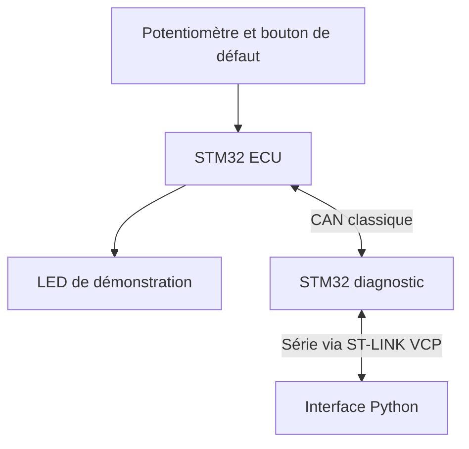

# SmartDiag — Banc de diagnostic embarqué sur bus CAN

**STM32 · C embarqué · CAN classique · Diagnostic · Python · Tests**

> Statut : conception documentée. Firmware, interface PC et essais matériels à réaliser. Ce dépôt ne contient pas encore de logiciel exécutable.

## Présentation

SmartDiag est un projet pédagogique de surveillance et de diagnostic d'un système embarqué distribué. Deux cartes STM32 échangent des mesures et des états par bus CAN. Une application Python, reliée au nœud de diagnostic par liaison série, doit permettre de consulter les données, commander une sortie de démonstration et enregistrer les événements.

Le but est de travailler la programmation embarquée, les communications, la détection de défauts et la validation, sur un banc de laboratoire reproductible.

## Problématique

Comment détecter une mesure invalide, une surchauffe simulée ou une perte de communication dans un système à plusieurs calculateurs, puis présenter un diagnostic compréhensible et placer la sortie dans un état maîtrisé ?

## Solution proposée

| Élément | Responsabilité prévue |
|---|---|
| Nœud ECU | Acquisition, commande d'une LED de démonstration, protections locales |
| Nœud diagnostic | Réception CAN, surveillance de présence ECU, passerelle série |
| Interface PC | Affichage, commandes, historique et export CSV |

La première version emploie une LED à la place d'un moteur. Un potentiomètre simule une température pour permettre des essais reproductibles. Le branchement d'un vrai capteur ou moteur constitue une extension.

## Objectifs de la version initiale

- Échanger des trames CAN standard entre deux nœuds.
- Acquérir une entrée analogique et afficher la température simulée.
- Commander la LED depuis le PC, avec arrêt sur perte de commandes.
- Détecter un défaut simulé de capteur et un dépassement de seuil.
- Détecter la disparition du nœud ECU.
- Exposer les défauts actifs et mémorisés.
- Produire des journaux et des preuves de tests.

## Choix de conception

| Paramètre | Proposition |
|---|---|
| Microcontrôleurs | Deux STM32 avec contrôleur CAN classique et broches accessibles |
| Couche physique | Deux modules transceiver CAN compatibles logique 3,3 V |
| Bus | CAN classique, identifiants 11 bits, débit cible 500 kbit/s |
| Développement | STM32CubeIDE, STM32CubeMX, HAL, C |
| Application PC | Python, tkinter, pyserial ; versions à figer lors de l'implémentation |
| Organisation initiale | Boucle coopérative et interruptions ; FreeRTOS en extension |
| Diagnostic | Protocole pédagogique propre au projet ; pas UDS/OBD-II |

La référence exacte des cartes reste à confirmer avant achat. Un contrôleur CAN intégré ne remplace pas le transceiver physique.

## Documentation

1. [Architecture et exigences](docs/ARCHITECTURE.md)
2. [Matériel et câblage](docs/HARDWARE.md)
3. [Protocole CAN et série](docs/PROTOCOL.md)
4. [Plan de réalisation](docs/ROADMAP.md)
5. [Plan de validation](docs/TEST_PLAN.md)
6. [Publication GitHub et CV](docs/GITHUB.md)

## Résultats

| Livrable | État |
|---|---|
| Documentation de conception | Disponible |
| Choix définitif des cartes et GPIO | À faire |
| Firmware ECU | À développer |
| Firmware diagnostic | À développer |
| Interface Python | À développer |
| Compilation STM32 et essais CAN | Non réalisés |
| Vidéo et mesures de performance | À produire |

## Limites

Ce projet cible un banc isolé, pas un véhicule réel. Il ne revendique aucune conformité automobile ou certification de sûreté. Les températures sont simulées en version initiale. Le défaut capteur est injecté par un bouton ; une entrée analogique flottante ne permet pas à elle seule de prouver une déconnexion de capteur.

## Évolutions possibles

Capteur réel, moteur avec driver adapté, encodeur, tests automatisés, analyse CAN, portage FreeRTOS, puis sous-ensemble UDS documenté. Ces éléments ne sont pas inclus dans la version initiale.

## Références techniques

- [STM32CubeIDE — STMicroelectronics](https://www.st.com/en/development-tools/stm32cubeide.html)
- [STM32CubeMX — STMicroelectronics](https://www.st.com/en/development-tools/stm32cubemx.html)
- [SN65HVD230 — Texas Instruments](https://www.ti.com/product/SN65HVD230)

## Auteur et licence

Renseigner le nom de l'auteur, la période et les contributions réelles avant publication. Aucune licence de redistribution n'est choisie automatiquement.
